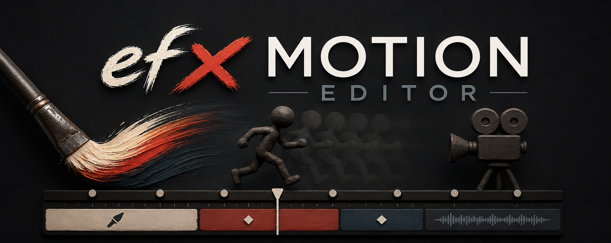

# EFX Motion Editor



A macOS desktop application for creating **cinematic stop-motion films** from photography keyframes: import key photographs, arrange them into timed sequences, composite multi-track layers with blend modes and keyframe animation, apply cinematic FX and GLSL shaders, paint and rotoscope frame-by-frame, and export PNG image sequences or video (ProRes/H.264/AV1). Alongside the photo pipeline stands a second pillar — the **Physics Paint Studio**: a standalone window where pressure-driven wet-media physics, a deterministic Roto timeline, a reusable Scripts library, and a per-document sound track turn hand-drawn animation into Loop Clips on the main timeline.

<!-- Screenshot: Main editor view -->

## Highlights (v1.0.0)

- **Multi-track EFX Paint document** — one parent paint layer now holds a whole frame-animation document: internal tracks with hide/solo/opacity/blend, a deterministic compositor, a fixed Background track, a photo/reference track, and Reveal.
- **Physics Paint Studio** — its own window (the main window hides while it is open): deterministic Roto timeline, project-scoped Scripts library, document sound track, pressure-driven physics look controls.
- **`.mce` project package** — manifest + per-layer JSON + WebP frame sidecars; references-only, digest-verified, changed-files-only atomic saves.
- **Modern HD frame runtime** — byte-backed frames with native Rust WebP decoding, a 512 MB decode LRU, a raised 1920 px working-resolution cap, and free canvas formats at project creation — HD landscape, vertical, portrait, square, or custom W×H.
- **Reveal** — photo sources revealed through paint/Script coverage, baked into keys.
- **Cinema pipeline** — 17 GPU shaders, 18 GL transitions, per-layer motion blur, multi-clip audio; ships as a signed and notarized macOS (Apple Silicon) build.

## Photo Workflow

### Key Photo Workflow

Import photos (JPEG, PNG, TIFF, HEIC) via drag & drop or file dialog, assign hold frame counts, and arrange into named sequences. Solid color, transparent, and gradient key entries sit alongside imported images — linear/radial/conic gradients with 2–5 stops, drag-positioned on a visual stop bar with HEX/RGBA/HSL editing, rendered in preview, thumbnails, and export.

<!-- Screenshot: Key photo strip with solid/transparent entries -->

### Multi-Sequence Timeline

New projects pick a canvas format — HD 1920×1080, HD Vertical 1080×1920, Portrait 1080×1350, Square 1080×1080, or Custom W×H steppers clamped 16–1920 px — with presets labelled for social delivery (YouTube; Instagram/Facebook posts; Reels/Stories/Shorts/TikTok vertical), plus a frame-rate preset row (6–60 fps) shared by Settings and New Project. Create, reorder, duplicate, and rename sequences with per-sequence frame rate and resolution; the canvas timeline offers zoom, scroll, thumbnails, and frame-accurate scrubbing.

<!-- Screenshot: Timeline with multiple sequences -->

### Layers & Compositor

Stack static images, image sequences, or video layers with opacity, blend modes (normal, screen, multiply, overlay, add), and transforms (position, scale, rotation, crop) with live canvas drag handles. Reorder with a single drag to any slot including top and bottom, `+ Layer` lands on top with the next free name, and double-click renames inline — names never reshuffle on reorder.

<!-- Screenshot: Layer compositing with transform handles -->

### Transitions

Fade in/out and cross-dissolve transitions (opacity and solid color modes) plus **18 GPU transitions** from [gl-transitions.com](https://gl-transitions.com/) through a dual-texture WebGL2 pipeline: Directional, Directional Wipe, Wipe Left, Wipe Down, Dissolve, Fade Color, Fade Grayscale, Swap, Window Slice, Slides, Cross Zoom, Zoom In Circles, Simple Zoom, Cross Warp, Cube, Pixelize, Dreamy, Glitch Memories. Browse with animated previews, quick-apply from the grid, and tune duration, easing curve, and per-shader parameters — swap shaders after applying without losing settings. Rendered in both the live preview and video export.

<!-- Screenshot: GL transition browser with animated previews -->

### Keyframe Animation

Per-layer keyframes with 4 interpolation curves (linear, ease-in, ease-out, ease-in-out) animating position, scale, rotation, opacity, blur, and FX parameters, with sidebar diamond editing and navigation. After Effects-style canvas motion paths show each layer's trajectory as a dotted trail — drag keyframes on the canvas to reshape paths with auto-seek and undo coalescing.

<!-- Screenshot: Keyframe animation controls -->

### Video Export

Export PNG image sequences with resolution multipliers, or encode ProRes/H.264/AV1 directly via auto-provisioned FFmpeg, following the project frame rate. Full timeline or single sequence; clicking Export shows immediate "Preparing" feedback (cancel works during preparation), then progress tracking with metadata sidecars and up to 128 sub-frame accumulation samples for motion blur. Paint content exports through the compositor — paint-only projects render every frame of the range in both canvas orientations.

<!-- Screenshot: Export dialog -->

## Physics Paint Studio

Physics-driven rotoscoping ships as **efx-physic-paint**, a complete interactive application running in its own Tauri window (the earlier headless batch adapter was abandoned in favor of this standalone window). Opening a Physics Paint layer launches the Studio as a single-window session: while the Studio is open the main window hides and the Studio owns the layer session.

<!-- Screenshot: Physics Paint Studio — Roto timeline -->

### Studio Window

- **Typed editor bridge** — the parent editor and the Studio communicate through a typed Tauri/postMessage bridge with exact acknowledgements ([`app/src/lib/physicPaintBridge.ts`](app/src/lib/physicPaintBridge.ts)), including native frame synchronization via the Tauri-native `physic-paint:seek-frame` path.
- **Launch & geometry** — double-click a Physics Paint layer row in the main sidebar to open the Studio; on every open the Studio window mirrors the main window's current bounds.
- **Main-editor identity** — the layer row shows its display name, accent color, and entry points; the layer spans the visible timeline view at the current zoom/scroll, and new layers stack at the top of the layer list.

### Deterministic Roto Timeline

- Stable physical-frame keys with direct frame positioning, generated interpolation, dynamic interpolation spacing controls, and a document-level interpolation mode.
- NLE-style ruler seek with a playhead bar — drags update only the playhead and audio mid-drag (full navigation settles on release); the viewport scrolls the complete frame range independent of the current selection, and on open it scrolls to the frame you launched.
- Live PNG pixel caching with durable alpha composites, cached playback, and real-key repaint.
- Undo/redo: accepted-only history, 10 levels per brush.
- Movement & groups: single-key drag, rigid multi-select group drag, group delete, and Force Spacing.
- Editing: Scissor splits generated frames mid-interpolation; + Key joins an existing rail when it lands inside a segment (or clears an interpolated frame to empty); Select All; Clear blanks the selected real key.
- Clipboard: group Copy, Paste, Duplicate, and fail-closed Cut.

### Roto Scripts Library

- Durable project-scoped library of reusable JSON presets with WebP thumbnails, plus a Copy Script / Apply Script clipboard. Tab bars and the Actions toolbar stay pinned while only the scripts list scrolls.
- Apply creates a Loop Clip on the main timeline — link to an existing cycle or create a new one; Play Script replays a multi-frame sequence into the source cycle (the former separate Play workflow lives here).
- Every Action from every physics layer is visible in the Scripts panel and applies to the layer that is current when you apply — with an All / current-layer scope selector.
- Apply and Clear live in the Tools popover under an Actions section.

<!-- Screenshot: Roto Scripts panel -->

### Document Sound Track

- The physics paint document carries its own sound clip (dialogue or foley for the animation being drawn): waveform in the Studio timeline, drag to reposition, trim start/end points.
- Studio playback plays the clip; the main editor plays it mixed with the main-timeline audio (music/ambience keeps its role and stays read-only in the Studio).
- Edits sync across both windows and survive save/reopen — `.mce` keeps the sound as a disk reference, never copied into the package.

<!-- Screenshot: Document sound waveform in the Studio timeline -->

### Pressure & Look Controls

- Tablet pressure drives stroke thickness: the settled silhouette follows the gesture (hairlines and tapers stay clean) with held-pose determinism, so frames do not boil.
- **Spread**, **Shape detail** (fractal outline noise scaled to local stroke width), paper grain scale (Tools, canvas + export, with post-bake paper tooth and a live dry overlay), brush smoothing, and water controls shape the wet-media look; a pressure-varying ribbon previews each stroke before it settles.
- Bristle deposit lays coherent translucent streaks along the ribbon — build-up by overlap, not salt-and-pepper.
- Tools: brush, eraser (fresh stroke clears the whole stroke; dry paint is a pixel eraser), temporary erase while Alt is held, Move for fresh strokes, and a Photoshop-style foreground/background swatch with X-swap.

## Features

### EFX Paint — Multi-Track Paint Document

One parent paint layer holds a complete multi-track frame-animation document — a v1.0 clean break: pre-v1.0 paint data is rejected with an explicit dialog, never migrated.

- Multiple internal frame tracks with track-local paint/Roto/PlayScript state, revisions, and caches; track CRUD, active selection, hide/solo (hide is a hard off-switch), opacity/blend, and cross-track drags — all from inline track-row controls (grip, hide, solo, blend), plus a document-level interpolation mode.
- Deterministic internal compositor: one flattened parent raster per frame, feeding both preview and export.
- Fixed Background track with imported Loop Clips (finite/infinite repeat, gaps, transparent fallback); background images imported from the Studio gallery persist across close/reopen, and the background can be moved, scaled, and rotated with the photo-reference transform handles — lockable in place.
- Photo/reference track: reference-only, reveal-source, or masked-transform-source modes.
- Read-only, frame-synchronized audio monitoring while editing — audible scrub and play-from-cursor.

<!-- Screenshot: EFX Paint multi-track timeline -->

### Reveal

A Reveal rail — the fourth rail kind — shows a photo source through paint/Script coverage: the reference as placed is masked by coverage alpha (destination-in) and baked into keys. Progressive and static Reveal modes; create, replay, resize, or delete the rail, each with its own undo.

<!-- Screenshot: Reveal rail with baked mask -->

### Paint Layer / Rotopaint

Frame-by-frame drawing and rotoscoping directly on the canvas, powered by a perfect-freehand brush engine with pressure-sensitive strokes, 8 tools (select, brush, path eraser, eyedropper, flood fill, line, rectangle, ellipse), and onion skinning with configurable range and opacity falloff.

- **Dual-mode paint** — each frame is Flat (vector strokes) or FX (p5.brush spectral pigment); conversion dialogs handle transitions with full undo, and the mode persists per layer.
- **Brush FX styles** — flat, watercolor, ink, charcoal, pencil, marker with Kubelka-Munk spectral pigment mixing (blue + yellow = green) and per-style parameters (bleed, grain, scatter, field strength, edge darken); per-frame batch rendering blends overlapping strokes in a single GLSL pass.
- **Select & edit** — move/resize/rotate/recolor/reorder strokes, Alt-drag duplicate, bezier path editing with anchors and control handles, progressive path simplify, wireframe overlay, and a stroke list panel with visibility toggles and drag reorder.
- **Stroke draw-reveal animation** — distribute a stroke's points across a frame range by drawing speed for hand-drawn reveals, with single-atomic undo.
- **Inline color picker** — Box, TSL, RVB, and CMYK modes with live gradient sliders, HEX sync, recents, and favorites; circle brush cursor at pixel size.
- **Paint mode** — sticky edit mode (P) with a dedicated toolbar, sequence overlay (O), copy-strokes-to-next-frame, and ESC to exit.
- **Tablet & pen support** — native macOS pressure bridge with easing/taper curves, tilt, and coalesced touch events (Wacom, Apple Pencil via Sidecar).

<!-- Screenshot: Paint overlay with brush FX styles -->

### Per-Layer Motion Blur

Hollywood-style per-layer directional blur with cinematographic shutter angle (0–360°). WebGL2 preview at Low (16) or Medium (32) samples, toggled with `M`; export renders 8–128 sub-frames per output frame accumulated in a Float32 buffer with GLSL velocity blur, overridable independently from preview. A per-layer velocity cache with seek invalidation skips layers below the motion threshold — zero cost for static elements. Settings persist in the project file.

<!-- Screenshot: Motion blur preview with shutter angle popover -->

### Audio

Import WAV, MP3, AAC, or FLAC with waveforms rendered on the timeline below content tracks. Multiple clips per project with per-clip gain (dB), fade in/out with curves (exponential by default), position and trim controls with fit-to-view, mute, and drag offset; a shared audio properties panel lives in the editor sidebar and the Studio, playback stays synced, and audio persists across save/reopen as disk references.

<!-- Screenshot: Audio waveform on timeline -->

### Cinematic FX Effects

Built-in generator effects (film grain, particles, lines, dots, vignette) and adjustment effects (color grade with presets, GPU-accelerated blur), all with per-layer keyframe animation and interpolation curves.

### GLSL Shader Library

17 GPU-powered shader effects ported from Shadertoy, in a visual browser with animated previews and real-time parameter controls:

- **FX image shaders** — B&W Pixel Filter, Super Film Grain, Color Fusion, Fast Blur, Color Temperature, CRT Screen, Filmora Shake.
- **Generator shaders** (procedural timeline layers) — Star Nest, Spiral Lit Clouds, The Drive Home, Clouds 3D Fly, Sun with Stars, Neon Doodle Fuzz, Seascape, Ocean Water, Indefinite, Zippy Zaps.

The library is extensible — see [`src/lib/shaders/SHADER-SPEC.md`](app/src/lib/shaders/SHADER-SPEC.md) for how to add new shaders.

<!-- Screenshot: GLSL shader browser with animated previews -->

### Media, Preview & Professional Controls

- Color-coded usage badges on imported assets, safe removal with cascade deletion and undo, and a right-click asset menu.
- Real-time preview with zoom/pan, pinch gestures, fit-to-window, fullscreen letterbox, and full-speed playback for performance testing.
- 3-level UI theme (dark/medium/light) on 28+ CSS variables, DaVinci Resolve-inspired.
- JKL shuttle scrubbing, 200-level undo/redo with drag coalescing, debounced + periodic auto-save with atomic writes, keyboard shortcuts with `?` overlay, global solo (`S`), and sequence isolation with loop playback.

<!-- Screenshot: Canvas preview with zoom -->

### Project Format — `.mce`

A portable package: the `project.mce` manifest, one `layers/<layerId>.json` sub-file per changed paint layer, and `frames/<layerId>/<keyId>.webp` frame media — references only, never inline payloads or machine-local paths. Saves are digest-verified, changed-files-only, and published atomically; audio stays a disk reference, never copied into the package. v1.0.0 is a clean break: pre-v1.0 Physics Paint data is refused with an explicit rejection dialog.

## What's New in v1.0.0

Phases 45 → 53 of the v1.0.0 milestone:

| Phase | Shipped |
|-------|---------|
| 45 | Versioned v1.0 EFX Paint document owned by the parent layer; clean-format break with explicit pre-v1.0 rejection |
| 46 | Track-local paint/Roto/PlayScript state, revisions, dirty tracking, and per-track caches |
| 47 | Internal multi-track timeline: track CRUD, active selection, hide/solo, opacity/blend, cross-track drags |
| 48 | Deterministic internal compositor — one flattened parent raster per frame |
| 49 | Fixed Background track with imported Loop Clips (finite/infinite repeat, gaps, fallback) |
| 50 | Photo/reference track — reference-only / reveal-source / masked-transform-source modes |
| 51 | Read-only audio monitoring in the editor — audible scrub and play-from-cursor |
| 52 | Shared mask compositor and Reveal rails |
| 52.1 | Modern frame runtime: bytes/ImageBitmap frames, Rust WebP decode, 512 MB LRU, native HD paint |
| 52.2 | `.mce` project package format — references-only, digest-verified atomic saves |
| 52.3 | Paint content export — paint-only projects enumerate every frame through the compositor |
| 52.4 | Real paint — structured bristle-footprint deposit replaces salt-and-pepper |
| 52.5 | Physics Paint document sound track — Studio waveform/trim/reposition + mixed main-editor playback |
| 53 | Integrated acceptance — automated gates, native UAT, signed/notarized release |

Alongside the phases, **84 completed quick tasks** (2026-08-27 → 2026-10-10, recorded in `.planning/STATE.md`), grouped by theme:

| Theme | Examples |
|-------|----------|
| Studio window & timeline UX | NLE ruler seek + playhead bar, workflow strip layout, pinned right panel, auto-position to opened frame, main-window geometry mirroring |
| Track rows & hide/solo | Hide is a hard off-switch, inline track-row controls, armed-solo badge, document-level interpolation mode |
| Physics look laws | Pressure-driven thickness, Spread recalibration, Shape-detail fractal noise, paper grain scale, preview == settled "one look law" |
| Studio tools | Eraser contract (fresh vs dry), Alt-to-erase, Move tool, foreground/background swatch, pressure-ribbon stroke preview |
| Scripts library | Project-scoped Actions with layer scope selector, Apply/Clear moved into the Tools popover |
| Multi-clip audio | Multiple audio clips per project, gain in dB, fade curves, waveform windowing, disk references with relink |
| Persistence & Studio sync | Rust-owned package file IO, gallery import persistence, Studio-origin state push fixes, second-layer gesture fixes |
| Sequences & canvas | Canvas size/orientation presets at project creation, span re-extend clamp, sequence-extension clamp, fond paper-first draw |
| Export | Export "Preparing" hoisted ahead of the Studio flush; paint-content enumeration verdict feeding phase 52.3 |
| Main-app integration | Physics layer row with double-click-to-Studio, layer spans the visible timeline view, new layers stack at the top, layer-stack reorder |

v1.0.0 ships as a Developer ID signed and Apple-notarized macOS (Apple Silicon) DMG. Production packaging safeguards include a complete frontend bundle entry, the generated EFX application icon set, system codesign resolution, and a production CSP with narrow data-URL grants.

## Canvas Motion Fork

This project uses [@efxlab/motion-canvas-*](https://www.npmjs.com/search?q=%40efxlab%2Fmotion-canvas) packages, a fork of [Motion Canvas](https://motioncanvas.io/). Currently used: core, 2d, vite-plugin, player, ui.

## Tech Stack

| Layer | Technology |
|-------|-----------|
| UI | Preact, @preact/signals, TypeScript, Tailwind CSS v4 |
| Build | Vite 5 |
| Preview Engine | @efxlab/motion-canvas-* (fork), Canvas 2D compositing |
| GPU Effects | WebGL2 (GLSL shaders, GPU blur, per-layer motion blur) |
| Native Backend | Rust, Tauri 2.0 |
| Video Export | FFmpeg (auto-provisioned) |
| Paint Engine | perfect-freehand (flat strokes), p5.brush (spectral pigment FX), fit-curve + bezier-js (path editing), @efxlab/efx-physic-paint (standalone Physics Paint engine with typed editor bridge) |
| Monorepo | pnpm workspaces, tsup (package builds) |
| Project Format | `.mce` package (manifest + per-layer JSON + WebP frame sidecars, references-only) |

## Prerequisites

- macOS (native title bar, file dialogs, macOS conventions)
- [Rust](https://rustup.rs/) toolchain
- [Node.js](https://nodejs.org/) (v18+)
- [pnpm](https://pnpm.io/)

## Getting Started

```bash
# Clone the repository
git clone https://github.com/your-username/efx-motion-editor.git
cd efx-motion-editor

# Install dependencies (from workspace root)
pnpm install

# Build the paint engine
pnpm --filter @efxlab/efx-physic-paint build

# Run in development mode
cd app
pnpm tauri dev
```

## Building for Production

```bash
cd app
pnpm tauri build
```

The built application will be available in `app/src-tauri/target/release/`.

## Testing

```bash
cd app
pnpm exec vitest run
```

Never run Vitest in watch mode.

## Project Structure

```
efx-motion-editor/                # pnpm workspace root
├── app/                          # Main Tauri application
│   ├── src/                      # Frontend (Preact + TypeScript)
│   │   ├── components/           # layout, timeline, sidebar, shader-browser,
│   │   │                         # physic-paint (Studio UI), overlay, shared
│   │   ├── stores/               # Reactive state (Preact signals)
│   │   ├── lib/                  # Renderers, GLSL shaders, paint, bridges,
│   │   │                         # physics paint bridge/persistence (see SHADER-SPEC.md)
│   │   ├── efx-paint/            # v1.0 multi-track paint document model
│   │   ├── types/                # TypeScript type definitions
│   │   └── scenes/               # Motion Canvas preview scene
│   └── src-tauri/                # Native backend (Rust + Tauri 2.0)
│       ├── commands/             # IPC command handlers
│       ├── models/               # Data structures (project format)
│       └── services/             # File I/O, image processing, thumbnails
├── packages/
│   └── efx-physic-paint/         # @efxlab/efx-physic-paint — natural-media paint
│                                 # simulation (wet/dry physics, fluids, paper texture)
├── docs/                         # Project docs and assets (README header artwork)
├── .planning/                    # GSD project planning
├── package.json                  # Workspace root (scripts, overrides, packageManager)
└── pnpm-workspace.yaml           # Workspace definition (app, packages/*)
```

## License

This project is licensed under the GNU General Public License v2.0 — see [LICENSE](LICENSE) for details.
